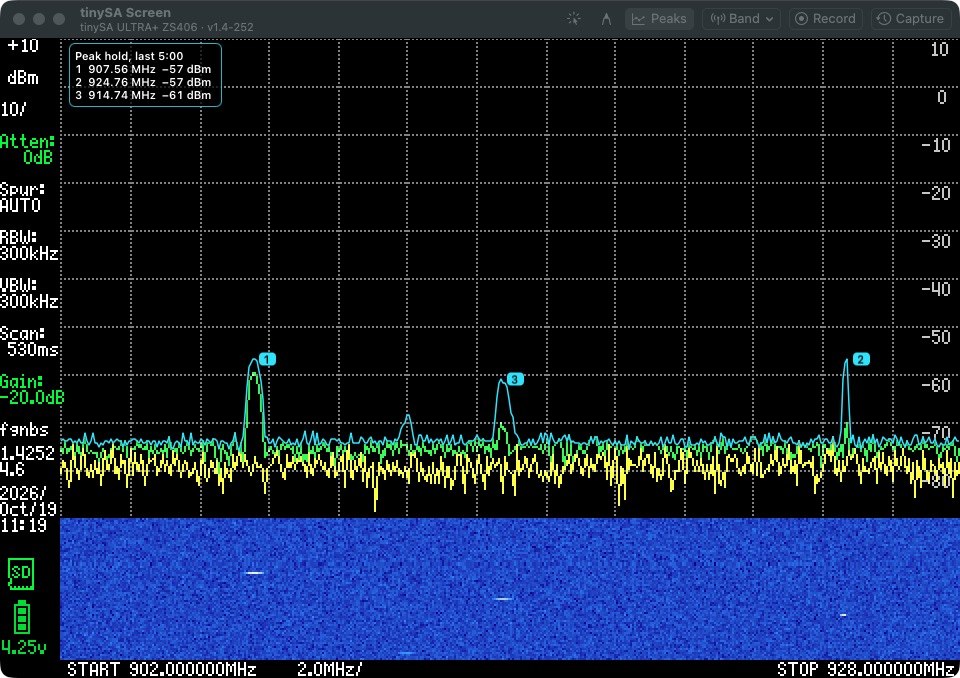
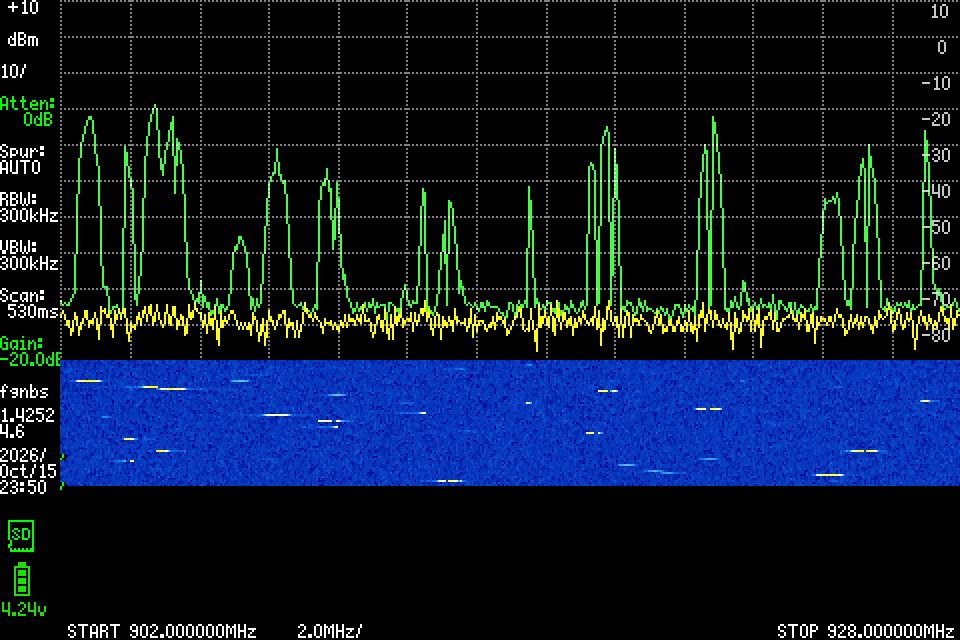
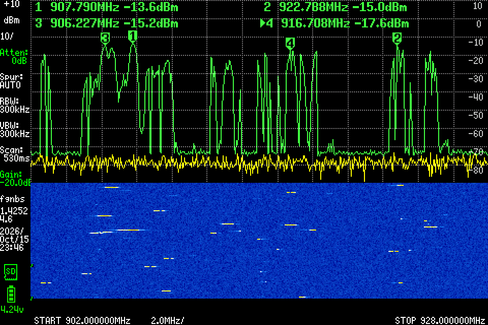
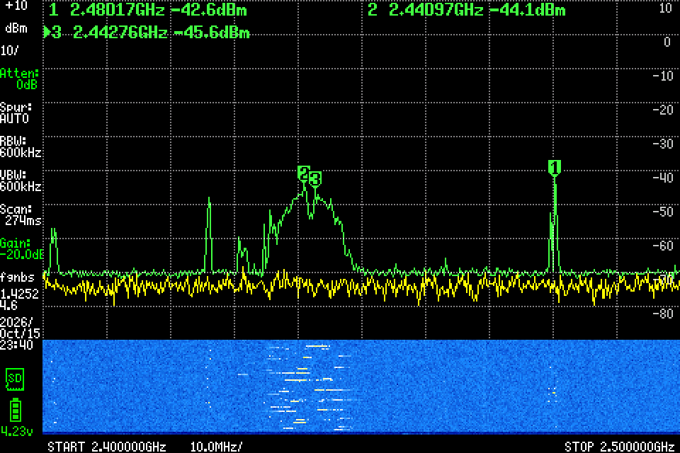
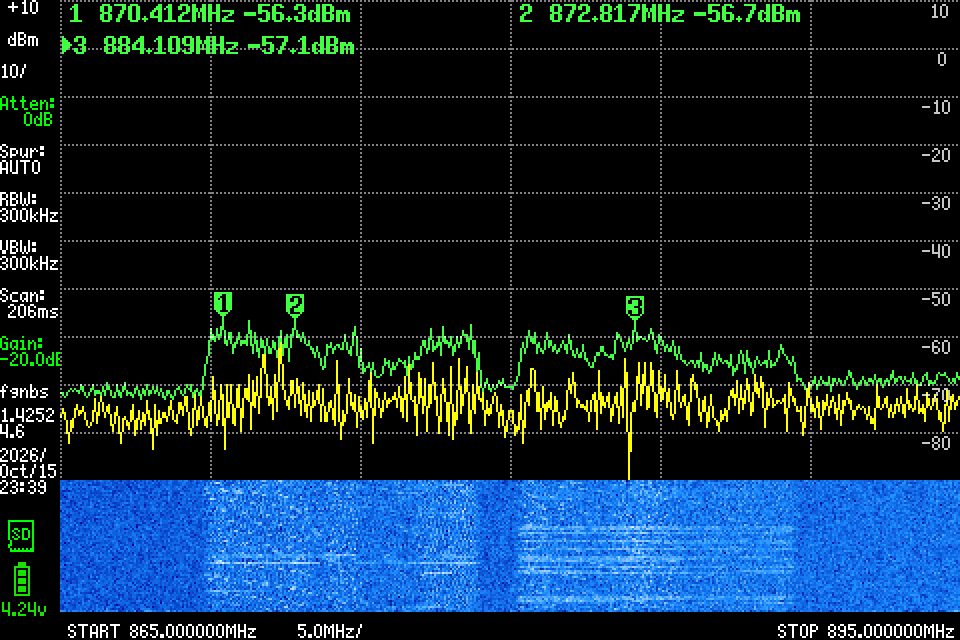
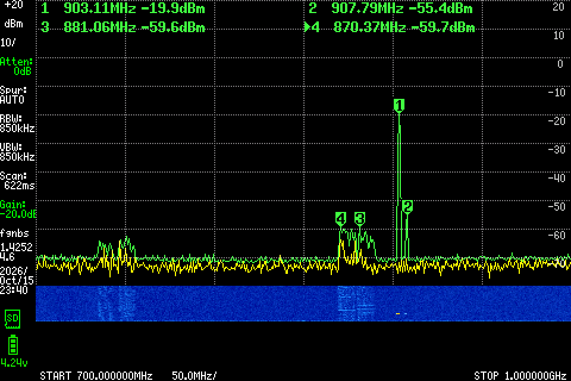
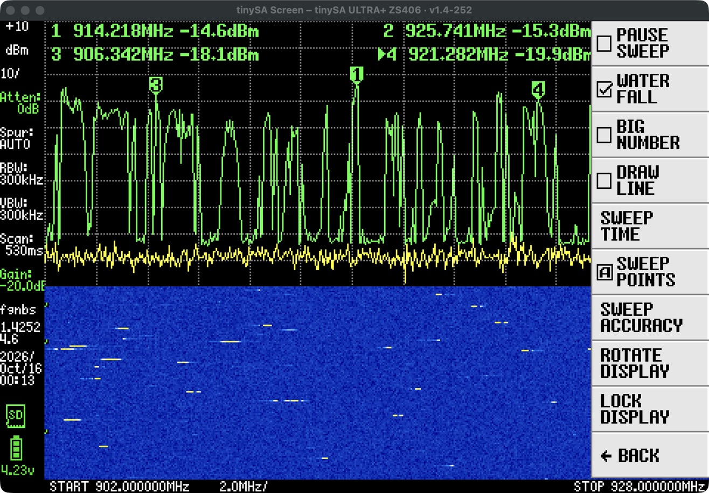
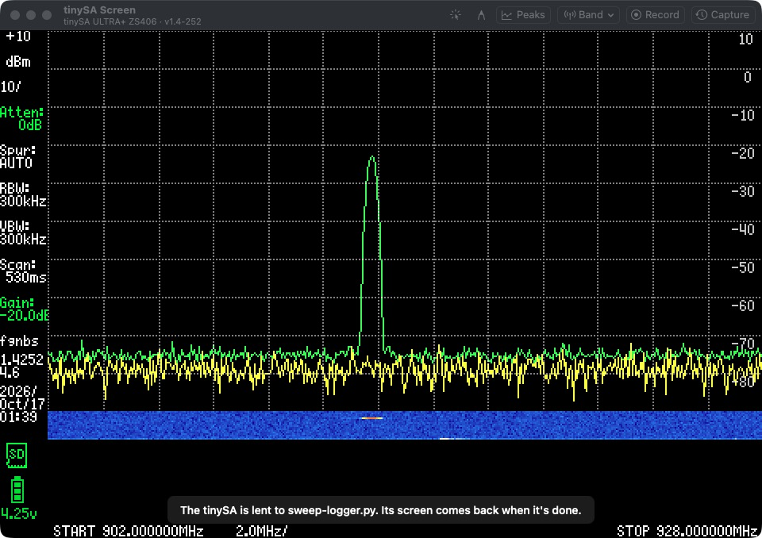

# tinySA Screen

[](https://github.com/tolgabalci/tinysa-screen/actions/workflows/ci.yml)
[](https://github.com/tolgabalci/tinysa-screen/releases/latest)

[](LICENSE)

The screen of your [tinySA](https://tinysa.org) spectrum analyzer, live in a window on your Mac. Share that window in
Teams, Zoom or Meet and everyone sees the band as you do. Click the picture and the analyzer takes it as a tap on its
own screen.



_tinySA Screen with a tinySA Ultra+ watching a UHF RFID reader hop across the 902–928 MHz band: the green line holds
the channels it used, four markers read them out, and each hop is a dash in the waterfall._

## Why

The tinySA is a small, capable spectrum analyzer with a 4-inch screen. Pointing a webcam at it during a call doesn't
show much. tinySA Screen puts its screen in a Mac window, pixel for pixel, as it changes:

- **Live**: the analyzer keeps sweeping as usual and sends what it draws over USB as it draws it, so the window shows
  each sweep, the markers, menus and the waterfall a moment after the analyzer does.
- **Sharp at any size**: twice the analyzer's size to start with, larger or full screen if you like, its pixels kept
  sharp.
- **Control from the Mac**: a click on the picture is a tap on the analyzer's screen, to open its menus, change the
  span or move a marker while you talk.
- **Bands in one click**: the Band menu sets the analyzer to FM radio, 433, 868 or 915 MHz, 2.4 GHz and more, or a
  band you saved, and back ([Bands](#bands)).
- **For presenting**: a red pointer everyone in the call sees, a pen whose strokes fade by themselves, and Float on
  Top ([Presenting](#presenting)).
- **Screenshots**: ⌘S saves the screen to the Desktop, ⌘C copies it.
- **Animated GIFs**: record the screen as a GIF (⌘R), or, when something odd has just happened, save the last minute
  that the app always keeps (⇧⌘R). Every pixel exact, the date and time ticking under the screen, and small: only
  what changes is stored ([Recording GIFs](#recording-gifs)).
- **A command line for scripts and AI agents**: `tinysa-screen record --seconds 30 --output band.gif`, with or
  without the app open ([The command line](#the-command-line)).
- **Works alongside your own programs**: a script that needs the analyzer borrows it and gives it back, and a program
  that keeps the analyzer all day can feed its pictures to the window instead ([Working with other programs](#working-with-other-programs)).



_Live: each sweep (yellow) as it comes, the green line holding the recent maximum, the waterfall filling with hops._

## What it looks like

| | |
| --- | --- |
|  |  |
| **902–928 MHz**: a UHF RFID reader hops among 50 channels; the green line holds where it went, with markers on four channels. | **2.4 GHz**: a Wi-Fi channel's 20 MHz hump at 2.44 GHz, its bursts in the waterfall, and a narrow signal at 2.48 GHz. |
|  |  |
| **869–894 MHz**: the cellular downlink, LTE carriers as wide plateaus. | **700–1000 MHz**: cellular bands at 700 and 850 MHz, and a strong burst in the 915 MHz band. |

All of these were taken with a tinySA Ultra+ (ZS406) on firmware v1.4-252, through a 20 dB attenuator and a 915 MHz
antenna.

## What you need

- A Mac with macOS 13 Ventura or later (Apple silicon or Intel).
- A tinySA connected by USB. Made and tested with a **tinySA Ultra+ (ZS406)**; the other tinySA Ultra models share its
  firmware and should work the same. The original tinySA (320 × 240 screen) should work too, but hasn't been tried:
  [tell us](https://github.com/tolgabalci/tinysa-screen/issues) how it goes.
- Recent firmware. The live screen (`refresh on`) has been in the firmware since 2021; v1.4-252 (September 2026) or
  later also captures the whole screen quickly and fixes a console hang of earlier versions. Firmware without the live
  screen gets a picture after every sweep instead (not yet tried on such firmware). See
  [Updating the firmware](#updating-the-firmware).

## Install

**Download**: get `tinySA-Screen-<version>.zip` from the [latest release](https://github.com/tolgabalci/tinysa-screen/releases/latest),
unzip it and move **tinySA Screen** to your Applications folder. The app isn't signed with an Apple Developer ID, so the
first time, open it with right-click (or Control-click) › **Open**, then **Open** again; macOS remembers that. On recent
macOS versions you may need System Settings › Privacy & Security › **Open Anyway** instead.

**Or build it yourself** (Xcode or its command line tools):

```bash
git clone https://github.com/tolgabalci/tinysa-screen.git
cd tinysa-screen
scripts/install.sh
```

That builds the app and puts it in `~/Applications`, where Spotlight finds it.

## Use

1. Connect the tinySA by USB and switch it on.
2. Open **tinySA Screen**. It finds the analyzer by itself (by its USB name, so no other serial device is touched), and
   the window's title names it and its firmware: "tinySA Screen – tinySA ULTRA+ ZS406 · v1.4-252".
3. In a call, share the window: in Teams, **Share › Window › tinySA Screen**; in Zoom, **Share Screen** and pick the
   window; in Meet, **Present › A window**. The window keeps updating when it's behind the call's own window.

| Menu | Keys | What it does |
| --- | --- | --- |
| File › Save Screenshot to Desktop | ⌘S | The analyzer's screen at its own size, as a PNG named `tinySA <date> at <time>.png` |
| File › Record GIF | ⌘R | Records the screen until you stop it (⌘R again), at most two minutes, and saves the GIF to the Desktop |
| File › Capture Last 1:00 as GIF… | ⇧⌘R | Saves the last minute, or the last part of it, as a GIF ([below](#recording-gifs)) |
| Edit › Copy Screenshot | ⌘C | The screenshot, to paste anywhere |
| View › Actual Size, Double Size, Triple Size | ⌘1, ⌘2, ⌘3 | The window at one, two or three of the Mac's points per analyzer pixel |
| View › Control the tinySA by Clicking | ⌘K | Clicks become taps on the analyzer (on by default) |
| View › Pointer | ⌘L | A red dot follows the mouse over the picture; Esc ends it ([Presenting](#presenting)) |
| View › Pen | ⌘D | Draw on the picture; strokes fade after a few seconds; Esc ends it |
| View › Enter Full Screen | ⌃⌘F | The picture as large as the screen allows |
| Band › (a band) | | Sets the analyzer to sweep that band ([below](#bands)) |
| Window › Float on Top | | The window stays above other apps' windows |
| tinySA Screen › Settings… | ⌘, | What Capture keeps, how GIFs look, saved bands, clicks and the pen |

A click on the picture is a tap on the analyzer's screen, even while the call's window is the active one: here the
analyzer's DISPLAY menu, opened from the Mac.



When no live picture can come, a note over the picture says why: no tinySA on USB, another program using it, or the
analyzer lent to a program for a while.

Quit tinySA Screen before you unplug the analyzer or hand it to another program by hand: it turns the analyzer's live
screen off as it quits.

## Presenting

Two buttons at the left of the title bar's buttons are for talking people through what's on the screen:

- **Pointer** (⌘L): a red dot follows the mouse over the picture, in place of the cursor. A call that shares the
  window doesn't always show the cursor, and when it does, it's small; the dot is part of the picture, so everyone sees
  it. A click makes a ring around the spot.
- **Pen** (⌘D): drag to draw on the picture, to circle a peak, say. Each stroke fades away after three seconds
  (Settings changes how long), so there's nothing to clear; the strokes stay on what they mark if the window changes
  size.

While either is on, clicks point or draw instead of tapping the analyzer; click its button again, or press Esc, to end
it. Neither goes into screenshots or GIFs, which are the analyzer's screen alone. **Window › Float on Top** keeps the
window above other apps' windows, for when you share your whole screen.

## Bands

The **Band** menu, in the title bar and the menu bar, sets the analyzer to sweep a band in one click: FM radio, airband,
marine VHF, the 2 m and 70 cm amateur bands, 433 MHz, 868 MHz (Europe) and 915 MHz (Americas) for LoRa and RFID,
2.4 GHz and 5 GHz Wi-Fi, cellular 700–900 MHz, ADS-B and GPS. **Back to** puts back the span the analyzer had before the
first band you chose, and **Save Current Span as a Band** keeps whatever span the analyzer sweeps now, set on the
analyzer itself, at the top of the menu (Settings removes it).

A band sets only the span, the analyzer's start and stop: its other settings stay as they are, and those it works out
from the span (resolution bandwidth, sweep time) follow it as they do when you set the span on the analyzer. Bands need
the analyzer on USB here and a tinySA Ultra; when a feeding program has the analyzer, set the band there.

## Recording GIFs

Two buttons in the window's title bar make animated GIFs of the analyzer's screen, to send after a call, put in a
report or paste into a chat:

- **Record** (⌘R) records from now until you click Stop, at most two minutes, and saves the GIF to the Desktop as
  `tinySA <date> at <time>.gif`. The button shows the time recorded.
- **Capture** (⇧⌘R) is for when something has just happened. tinySA Screen keeps the last minute of the screen all the
  time (in memory only), and Capture shows a sheet with a slider: keep the whole minute, or drag for the last 15 seconds,
  say. A picture of the GIF's first frame shows where it starts. Choose whether the date and the time go under the
  screen, the size, then **Save to Desktop**, or **Copy** to paste it into a chat or an email as an animated GIF. The
  sheet says how large the file will be before you save it.

What's in a GIF:

- **The screen exactly**, frame by frame as the analyzer drew it: one frame after each sweep, at the real time between
  sweeps, so the GIF plays as it happened. No dithering, no blur: a tinySA's screen has fewer colours than a GIF holds.
- **The date and time** in a strip under the screen, at its bottom right, in your Mac's formats, the time to the
  second and ticking as the GIF plays (both can be turned off).
- **Small files**: only the part of the screen that changed since the frame before is stored, and a screen that keeps
  still costs nothing. A minute of a busy band takes about 300 KB at the sharp size (125 KB small); with the
  analyzer's waterfall on, which changes every sweep, 2 to 4 MB (under half that small).
- **Two sizes**: Sharp (twice the screen's size, 960 × 672 for a tinySA Ultra, every pixel a sharp 2 × 2 square) or
  Small (the screen's own size).

Settings (⌘,) sets how many seconds Capture keeps (5 seconds to 2 minutes, or none), and the date, time and size that
Record uses and Capture starts from.

## The command line

The app is also a command-line tool, for scripts, test benches and AI agents. Link it once:

```bash
ln -s "/Applications/tinySA Screen.app/Contents/MacOS/tinysa-screen" /usr/local/bin/tinysa-screen
```

```bash
tinysa-screen record --seconds 30 --output band.gif     # record 30 seconds from now
tinysa-screen capture --seconds 15 --output last.gif    # the last 15 seconds the open app kept
tinysa-screen screenshot --output screen.png
tinysa-screen record -s 20 --start 2.4G --stop 2.4835G -o wifi.gif   # a given band, then the span put back
tinysa-screen sweep --start 902M --stop 928M            # set the span (sweep alone reads it)
tinysa-screen status --json                             # what it sees, for programs
```

With the app open, the app does the work and its window says who is recording; without it, the command works alone,
sharing the analyzer the same way. Results come as a line of text or, with `--json`, of JSON.
[docs/COMMAND-LINE.md](docs/COMMAND-LINE.md) has everything, including the socket the app answers on, for other
languages.

## Working with other programs

A tinySA's USB console takes one program at a time. tinySA Screen shares it in two ways, and answers programs that ask
it for GIFs; each is a few lines in any language. [docs/INTEGRATION.md](docs/INTEGRATION.md) has the details, and
Python helpers are in [integrations/python](integrations/python):

- **Borrowing.** A script that needs the analyzer for a while writes its process ID and name to `~/.tinysa-busy`.
  tinySA Screen lets go within about half a second, shows who has the analyzer, and takes it back when the file is
  gone.

  ```bash
  echo "$$ my-script" > ~/.tinysa-busy   # tinySA Screen lets go of the tinySA
  # ... use the tinySA ...
  rm ~/.tinysa-busy                      # and takes it back
  ```

  

- **Feeding.** A program that keeps the analyzer itself (a monitor or logger running all day) can put the analyzer's
  screen in the window: while tinySA Screen is open it touches a file, and the program writes the screen as a PNG and
  a few words about what it is doing to a folder the app watches. While that program runs, tinySA Screen shows its
  pictures and never touches the analyzer. Record and Capture work on fed pictures too.
- **Asking.** A program can ask the open app for a GIF, a screenshot or its status, through the
  [command line](#the-command-line) or the socket behind it.

## How it works

tinySA Screen speaks the analyzer's USB console, as a terminal would. When it connects it turns off any live screen a
crashed viewer may have left on, asks for the firmware version and the model, captures the whole screen (`capture rle`:
the screen packed into about 30 KB), then sends `refresh on`. From then on the analyzer sends every region it draws, as
it draws it, and the app paints the regions onto its copy of the screen. Clicks go back as `touch x y` and
`release x y`. GIFs come from the app's own encoder: a frame once each sweep is drawn, in its exact colours, only the
rectangle that changed, compressed with GIF's LZW. [docs/HOW-IT-WORKS.md](docs/HOW-IT-WORKS.md) describes the formats
and the GIFs.

## Troubleshooting

| What you see | What to do |
| --- | --- |
| "Connect a tinySA by USB and switch it on." | Check the cable (a charging-only cable doesn't carry data) and the switch on the analyzer. |
| "The tinySA is in use by another program" | Quit that program (another viewer, a terminal, NanoVNA-Saver or QtTinySA), or make it [borrow](docs/INTEGRATION.md#borrowing) the analyzer. |
| "The tinySA doesn't answer over USB." | Switch the analyzer off and on. Firmware before v1.4-223 could leave its console unable to answer after hours of use; [update it](#updating-the-firmware). |
| The analyzer's own screen froze after tinySA Screen crashed | Open tinySA Screen again (it turns the analyzer's live screen off as it connects), or switch the analyzer off and on. |
| macOS says the app "can't be opened" | Right-click › Open the first time, or System Settings › Privacy & Security › Open Anyway. |

### Updating the firmware

The tinySA's maker publishes each firmware release in the [tinySA4 download folder](https://athome.kaashoek.com/tinySA4/DFU/)
(the Ultra models) with its changelog, and explains how to install it on the [tinySA wiki](https://tinysa.org/wiki/).
From v1.4-252 on the analyzer can also update itself from its SD card (STORAGE › MORE › UPDATE FIRMWARE).

## Contributing

Bug reports, ideas and pull requests are welcome: see [CONTRIBUTING.md](CONTRIBUTING.md). Reports about tinySA models
and firmware versions this hasn't been tried with are especially useful.

## Acknowledgments

- The [tinySA](https://tinysa.org) is designed by Erik Kaashoek; its firmware ([on GitHub](https://github.com/erikkaashoek/tinySA))
  has the live screen and touch commands this app uses, made for the Windows app tinySA-App.
- `capture rle` sends the screen in the RLE8 format of DiSlord's NanoVNA-D firmware.

tinySA Screen is an independent project, not made or endorsed by the makers of the tinySA.

## License

[MIT](LICENSE) © 2026 Tolga Balci
