# tinySA Screen

[](https://github.com/tolgabalci/tinysa-screen/actions/workflows/ci.yml)
[](https://github.com/tolgabalci/tinysa-screen/releases/latest)

[](LICENSE)

**The big screen your tinySA deserves**

Your [tinySA](https://tinysa.org) has a 4-inch screen. Your Mac has a much bigger one.

tinySA Screen shows the analyzer's display in a window on your Mac, live and sharp at any size, and you can use your
mouse on the tinySA's screen: open a menu, change the span or drag a marker. The peak hold labels every signal as it
shows up, with its time, frequency and level. Press Record and the burst you just saw is already in the GIF, ready to
trim and paste into a chat. In a Teams, Zoom or Meet call, share the window and everyone sees the band as you do.

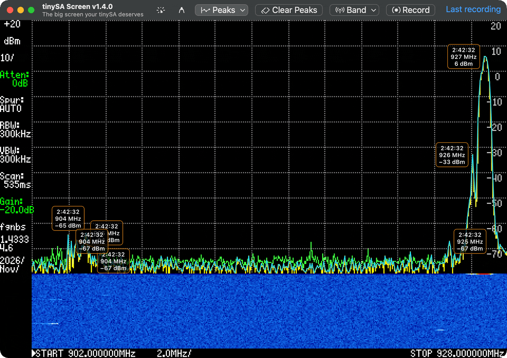

_A tinySA Ultra+ on the 902–928 MHz band as an RFID reader starts an inventory, at twice the speed. The peak hold (cyan)
catches each hop and labels the highest peaks with the time, the frequency and the level, while the waterfall underneath
fills with the bursts. The title bar holds the pointer and pen, Peaks, Clear Peaks, Band, Record and the link to the
last recording._

## What it does

- **Live and sharp.** Every sweep, menu and line of the waterfall shows up a moment after the analyzer draws it, pixel
  for pixel, at twice the analyzer's size or bigger, up to full screen.
- **Mouse control.** Click to tap the analyzer's screen, or hold the button to keep touching (to drag a marker). A
  right-click is a long press, and Esc backs out to the main screen. It works while you're in a call's window too.
- **Peaks you can read.** The peak hold runs on the Mac and leaves the analyzer's own settings alone. Each peak gets a
  label right where it is: when it came in, its frequency and its level. Where peaks crowd together, labels step aside
  with an arrow. One click switches to a box instead, or to a list beside the screen that you can save for a
  spreadsheet.
- **GIFs that start before you press Record.** The app always keeps the last minute. Trim the GIF in the editor and play
  it up to 20 times faster, then save it or copy it straight into a chat. The peaks come along with the date and time,
  and the peak hold can start fresh at the GIF's first frame.
- **Bands in one click.** FM radio, 433, 868 and 915 MHz, 2.4 GHz Wi-Fi, cellular and more, or a span you saved.
- **A red pointer and a pen.** Everyone on a call sees both, and the pen's strokes fade by themselves.
- **Scriptable.** A command line for scripts, test benches and AI agents, with or without the app open.

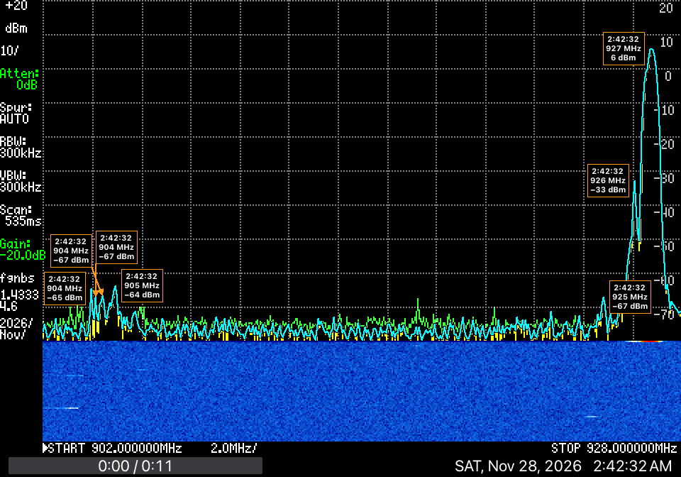

_The GIF tinySA Screen made of those same 12 seconds: every frame exactly as the analyzer drew it, the peaks labeled as
they came in, and the date and time ticking under the screen. Under 1 MB._

## What it looks like

| | |
| --- | --- |
| 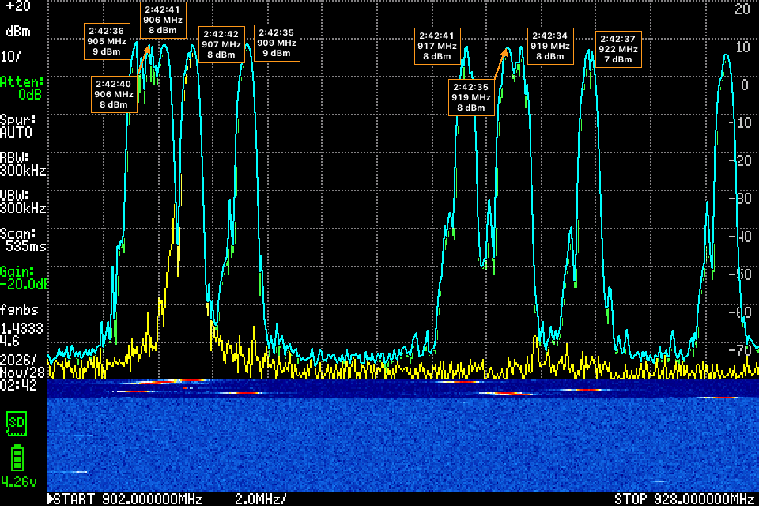 | 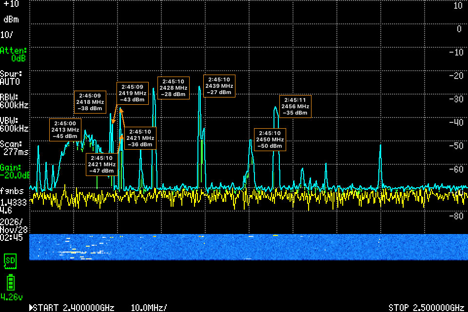 |
| **902–928 MHz**: an RFID reader hopping from channel to channel during an inventory. | **2.4 GHz**: Wi-Fi and Bluetooth bursts across the band, each a dash in the waterfall. |
| 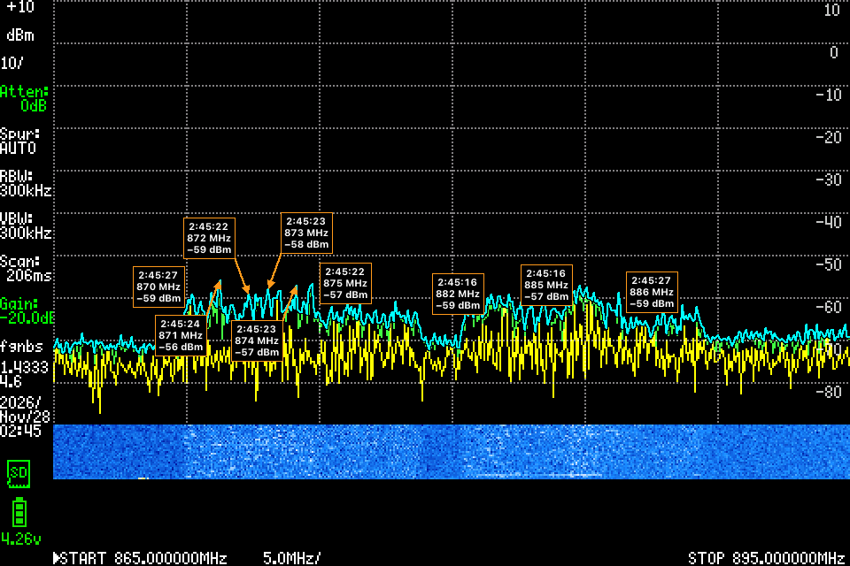 | 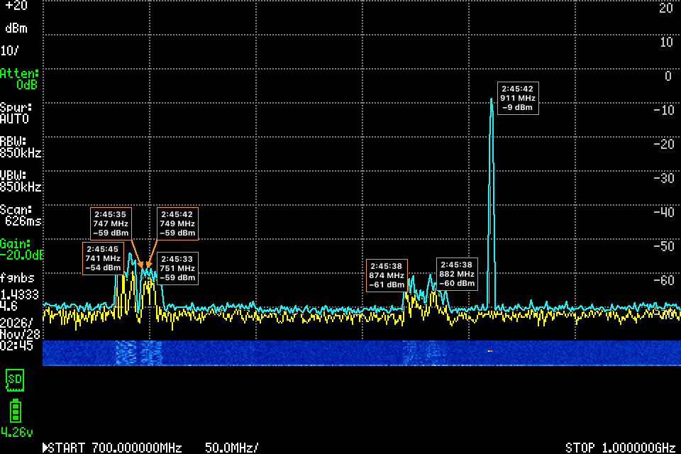 |
| **865–895 MHz**: the cellular downlink, its LTE carriers as wide plateaus. | **700–1000 MHz**: the cellular bands at 700 and 850 MHz, and an RFID reader at 911 MHz. |

Screenshots straight from the app (⌘S): the analyzer's screen at twice its size, with the peak hold over it. Taken with
a tinySA Ultra+ (ZS406) on firmware v1.4-333, through a 20 dB attenuator and a 915 MHz antenna.

## Install

With [Homebrew](https://brew.sh):

```bash
brew install --cask tolgabalci/tap/tinysa-screen
```

That puts **tinySA Screen** in your Applications folder and `tinysa-screen` (the [command line](#the-command-line)) on
your `PATH`. `brew upgrade` brings new versions.

**Or download** `tinySA-Screen-<version>.zip` from the [latest release](https://github.com/tolgabalci/tinysa-screen/releases/latest),
unzip it and move **tinySA Screen** to your Applications folder. It's signed with a Developer ID and notarized by Apple,
so it opens like any other app.

**Or build it yourself** (with Xcode or its command line tools):

```bash
git clone https://github.com/tolgabalci/tinysa-screen.git
cd tinysa-screen
scripts/install.sh
```

That builds the app and puts it in `~/Applications`, where Spotlight finds it.

## What you need

- A Mac with macOS 13 Ventura or later (Apple silicon or Intel).
- A tinySA connected by USB. It's made and tested with a tinySA Ultra+ (ZS406). The other tinySA Ultra models share
  its firmware and should work the same way. The original tinySA (320 × 240 screen) should work too but hasn't been
  tried yet: [tell us](https://github.com/tolgabalci/tinysa-screen/issues) how it goes.
- Recent firmware. The live screen (`refresh on`) has been in the firmware since 2021. v1.4-252 (September 2026) or
  later also sends the whole screen quickly and fixes a console hang of earlier versions. Firmware without the live
  screen gets a picture after every sweep instead (not tried yet on such firmware). See
  [Updating the firmware](#updating-the-firmware).
- **NanoVNA (experimental)**: a NanoVNA-H or -H4 shows the same way, live with
  [DiSlord's NanoVNA-D firmware](https://github.com/DiSlord/NanoVNA-D) (where the tinySA's console and live screen come
  from), or a picture every half second with older firmware. Clicks, screenshots, GIFs and the presenting tools work;
  bands and the peak hold are for the tinySA's spectrum. It's built from NanoVNA-D's source but not tried on a NanoVNA
  yet. With a tinySA and a NanoVNA both connected, the tinySA is shown.

## Getting started

1. Connect the tinySA by USB and switch it on.
2. Open **tinySA Screen**. It finds the analyzer by itself, by its USB name, so no other serial device is touched.
3. In a call, share the window: in Teams, **Share › Window › tinySA Screen**; in Zoom, **Share Screen** and pick the
   window; in Meet, **Present › A window**. The window keeps updating while it's behind the call's own window.

### Using the analyzer with your mouse

The picture is the analyzer's touch screen. Click it and the tinySA reacts as if you tapped its glass: here the main
menu, opened from the Mac. Hold the mouse button to keep touching, to drag a marker along the trace, say, and a touch
held half a second is a long press (on the keypad, the erase key then clears the whole entry). A right-click, a
two-finger click or a Control-click is a long press without holding. Esc takes the analyzer back to its main screen:
a number you're typing is cancelled and an open menu closes. Clicks go through even while the call's window is the
active one.

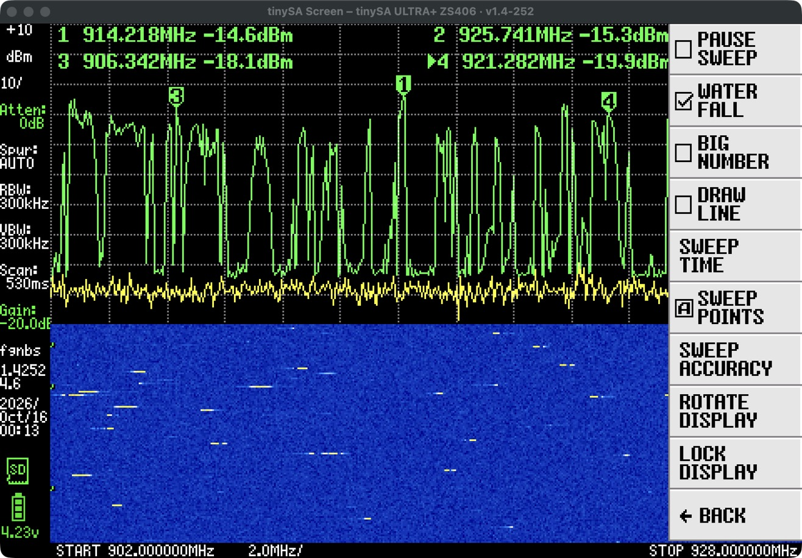

When no live picture can come, a note over the picture says why: no tinySA on USB, another program using it, or the
analyzer lent to a program for a while. Quit tinySA Screen before you unplug the analyzer or hand it to another program
by hand, since it switches the analyzer's live screen off as it quits.

### Menus and keys

| Menu | Keys | What it does |
| --- | --- | --- |
| File › Save Screenshot | ⌘S | The analyzer's screen as a PNG, at its own size (twice that with the peak hold over it), named `tinySA <date> at <time>.png`, on the Desktop or in the folder the GIF editor last saved to |
| File › Record GIF | ⌘R | Records the screen, starting 5 seconds before you pressed it, until you stop it (⌘R again); Stop opens the editor ([Recording GIFs](#recording-gifs)) |
| File › Stop and Save Recording | ⌥⌘R | Stops and saves the GIF as it is, without the editor |
| Edit › Copy Screenshot | ⌘C | The screenshot, to paste anywhere |
| View › Actual Size, Double Size, Triple Size | ⌘1, ⌘2, ⌘3 | The window at one, two or three of the Mac's points per analyzer pixel |
| View › Control the tinySA by Clicking | ⌘K | Clicks become taps on the analyzer (on by default) |
| View › Back to the tinySA's Main Screen | Esc | Closes what's open on the analyzer's screen |
| View › Pointer | ⌘L | A red dot follows the mouse over the picture ([Presenting](#presenting)) |
| View › Pen | ⌘D | Draw on the picture; strokes fade after a few seconds |
| View › Peak Hold | ⌥⌘P | The peak hold over the picture ([Peak hold](#peak-hold)) |
| View › Clear Peak Hold | ⌥⌘⌫ | Starts the peak hold over (also Clear Peaks, beside Peaks in the title bar) |
| View › Hold Peaks For | | How long the peak hold keeps each level: 10 or 30 seconds, a minute (the default), 5 minutes, or until cleared |
| View › Enter Full Screen | ⌃⌘F | The picture as large as the screen allows |
| Band › (a band) | | Sets the analyzer to sweep that band ([Bands](#bands)) |
| Window › Float on Top | | Keeps the window above other apps' windows |
| tinySA Screen › Settings… | ⌘, | Recording, GIFs, the peak hold, saved bands, clicks and the pen |

## Peak hold

**Peaks** in the title bar holds the highest level the analyzer's live trace (the yellow one) reaches at each
frequency, as a cyan line over the picture, and points out the highest peaks with when each one came in. Its menu
chooses how they show, and ⌥⌘P turns it on and off:

- **Labels beside the peaks** (the default): the time, the frequency to the nearest megahertz and the level, right at
  each peak: "11:09:21 / 911 MHz / −58 dBm". Where peaks crowd together, the older peak keeps its label beside it and
  a newer one's goes close by, touching its peak when that's clearly its own, or far enough away for an arrow to show,
  never over another label or another peak's top. Labels and arrows are edged in orange so they're never mistaken for
  the held line (Settings › Peak hold › Labels and arrows chooses another colour).
- **A box over the graph**, which finds itself an empty spot: the hold's period, then each peak by its number on the
  screen, in the order they came in:

  ```
  Peak hold, last 1:00
  3  11:08:52 PM  906.17 MHz  −23 dBm
  1  11:09:21 PM  911.27 MHz  −55 dBm
  ```
- **A list beside the screen**: every peak since the app started, a row each with its number, time, frequency and
  level, newest at the bottom. A peak no longer held stays, greyed. Point at a row and its peak gets a ring on the
  screen. **Save** writes the list as a CSV file for a spreadsheet.

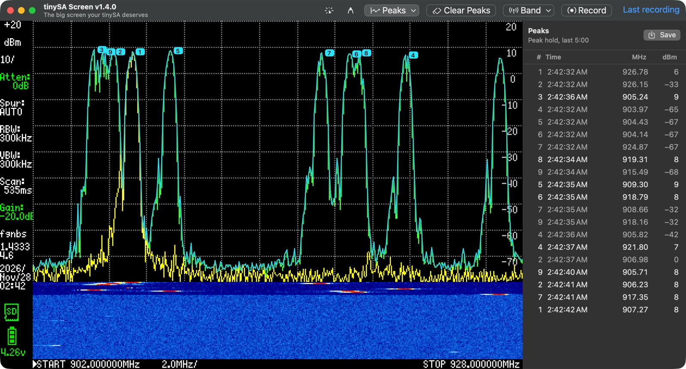

**Clear Peaks**, next to Peaks while the hold is on (⌥⌘⌫), starts it over.

It's all done on the Mac, from the analyzer's screen after each sweep, so the analyzer's own traces, markers and
settings stay as they are, and it works on a feeding program's pictures too. The frequencies and levels come from the
screen's own labels (the span under the graph, the levels at its right), read with the Mac's text recognition. They're
as fine as the screen's pixels: a column of the graph (58 kHz across 26 MHz) and a row (half a decibel at 10 dB a
division). On a sweep that caught a reader's burst, the peak hold read 902.23 MHz and −23 dBm where the analyzer's own
marker said 902.231 MHz and −23.2 dBm.

A peak is a top that stands at least 6 dB above the valleys around it and above the trace's noise. Each keeps its
number while it's held, the way an analyzer's markers stay on their peaks: a higher one coming along doesn't renumber
the others, and a new peak takes the lowest number free. The analyzer's menus and keypads aren't taken for the trace.

- **How long**: each level stays a minute after the trace last reached it, then goes, the way a monitoring hold keeps
  the last minute. **View › Hold Peaks For** (or Settings) makes that 10 or 30 seconds, 5 minutes, or until cleared.
- **Its colour**: cyan, the one colour none of the analyzer's own traces use (they're yellow, green, red and magenta),
  so the held line never passes for one of them. Settings › Peak hold › Color chooses another.
- **When the levels change**, by hand or by the analyzer's automatic reference level as strong signals come and go,
  what's held moves to the new scale and every peak keeps its number and time. A level above the new top stays at the
  top, as the analyzer draws it.
- **Another span** (a band chosen) starts the hold over. A menu opened over the labels for a while doesn't lose what
  was held.

Settings also chooses how many peaks to label (up to 9). Screenshots show the peak hold while it's on, at twice the
screen's size so it can be read, and GIFs show it where it was on while recording. `tinysa-screen peaks` gives the same
peaks to scripts ([The command line](#the-command-line)).

## Recording GIFs

**Record** in the title bar (⌘R) makes an animated GIF of the analyzer's screen, to send after a call, put in a report
or paste into a chat. tinySA Screen keeps the last minute of the screen in memory all the time, so the GIF starts 5
seconds before you pressed Record, and the whole minute is there if what you wanted came earlier. While it records, the
button turns into **Stop** with the GIF's length so far.

**Stop** opens the editor in a window of its own, with the whole recording on a filmstrip and the GIF between two
yellow handles:

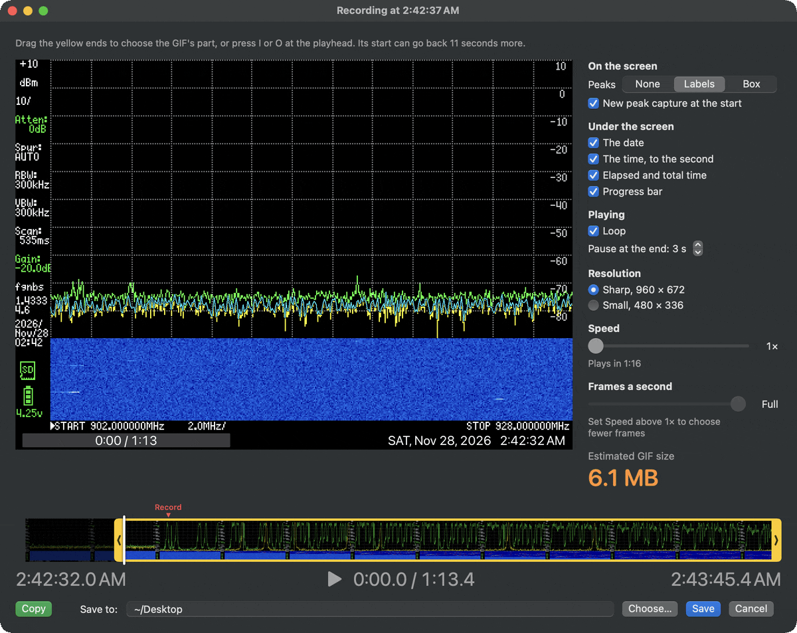

- **Drag the handles** to trim the GIF, or drag the start back into the dimmed part, the seconds kept from before you
  pressed Record. The picture shows the frame under the handle as the GIF will, date and time included. Hold ⌥ for finer
  steps, and double-click a handle to take it all the way to the recording's start or end.
- **Play** (Space, or a click on the picture) plays the GIF in a loop, as it will play.
- **The keys are QuickTime Player's**: ← and → step a frame (⇧ for a second), ⌥← and ⌥→ go to the GIF's start and end,
  I and O set the start or end at the playhead, and ⌘Z undoes.
- **Peaks**: None, Labels or Box, where the hold was on while recording. **New peak capture at the start**, on unless
  you uncheck it, starts the hold over at the GIF's first frame, as if you'd pressed Clear Peaks right then, so people
  watching see only the peaks that came in during the GIF. Unchecked, the GIF shows the hold as the window had it.
- **Under the screen**: the date, the time to the second, the time into the GIF ("0:10 / 2:30") and a progress bar,
  each one optional.
- **Playing**: loop or play once, a pause at the end (3 seconds unless you change it), and a speed from 1× to 20×:
  a minute at 10× plays in 6 seconds. Above 1×, **Frames a second** can bring the frame rate down for a smaller file.
- **Resolution**: Sharp (twice the screen, every pixel a crisp 2 × 2 square) or Small, and the estimated GIF size in
  large type: green under 2 MB, orange to 10 MB, red past that.
- **Copy** (⌘C) puts the GIF on the clipboard to paste into a chat or an email; **Save** (Return) writes it, as `tinySA
  <date> at <time>.gif`, to the folder in **Save to**; **Cancel** (Esc) asks before it throws the recording away.

Hold ⌥ while recording and Stop becomes **Stop & Save**, which saves the GIF as it is without the editor (⌥⌘R too). A
recording stops by itself two minutes after Record and opens the editor, and quitting saves a recording that's running
or waiting in the editor.

**Last recording**, a link next to Record once you've made a GIF, opens the latest one to watch. It pulses for a few
seconds when a GIF is saved, so you can see where it went.

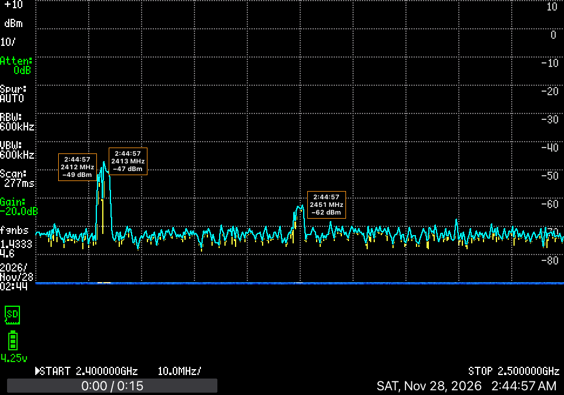

_A GIF from the editor: 15 seconds of the 2.4 GHz band, its peaks labeled as they came in, under 700 KB at the sharp
size._

What's in a GIF:

- **The screen exactly**, as the analyzer drew it, in real time or as many times faster as you chose. The GIF moves on
  in tenths of a second, each the screen as it was then, so its seconds tick exactly a second apart in any player. No
  dithering and no blur: a tinySA's screen has fewer colours than a GIF can hold.
- **A strip under the screen**: on the right the day, date and time ("SAT, Nov 28, 2026   10:15:32 PM", as your Mac's
  language writes them); on the left a bar that fills as the GIF plays, with "0:10 / 2:30" in it. Through a second when
  no picture came from the analyzer, the times tick on in pink. Through the pause at the end, "END OF RECORDING" in red.
- **Small files**: only the rows of the screen that changed are stored, and a screen that keeps still costs nothing. A
  minute of a busy band takes about 550 KB at the sharp size; with the analyzer's waterfall on, which changes every
  sweep, 3 to 6 MB.
- **Safe to post**: every image in the file is as wide as the GIF and has no transparent pixels, so forums that shrink
  GIFs frame by frame (groups.io does) still show the screen properly.

**Settings › Recording** (⌘,) sets how much is kept in memory (15 seconds to 5 minutes, or nothing), how far before
Record a GIF starts, and how long a recording runs at most after Record (1 to 5 minutes), so a GIF can be up to ten
minutes long.

### Where files go

GIFs and screenshots go to the Desktop until you save a GIF somewhere else. The editor's **Save to** shows the folder:
type over it (a new folder is made when the GIF is saved), click **Choose…**, or drop a folder on it. The folder you
save a GIF in is kept, so the next editor starts with it, and Stop & Save and ⌘S save there too.

- A folder that's moved or renamed is followed.
- While the folder can't be found (on a drive that's unplugged, say) or can't be written to, the file goes to the
  Desktop and the window says so. A recording is never lost for want of its folder.
- Files are named after when they start and never replace each other: a second file from the same second gets " (2)".
- The command line writes where its `--output` says.

## Bands

The **Band** menu, in the title bar and the menu bar, sets the analyzer to sweep a band in one click: FM radio,
airband, marine VHF, the 2 m and 70 cm amateur bands, 433 MHz, 868 MHz (Europe) and 915 MHz (Americas) for LoRa and
RFID, 2.4 GHz and 5 GHz Wi-Fi, cellular 700–900 MHz, ADS-B and GPS. **Back to** returns to the span the analyzer had
before the first band you chose, and **Save Current Span as a Band** keeps whatever span the analyzer sweeps now at the
top of the menu (Settings removes it).

A band sets only the span, the analyzer's start and stop. Its other settings stay as they are, and the ones it works
out from the span (resolution bandwidth, sweep time) follow, just as when you set the span on the analyzer. Bands need
a tinySA Ultra on USB here; when a feeding program has the analyzer, set the band there.

## Presenting

Two buttons at the left of the title bar's buttons help you talk people through what's on the screen:

- **Pointer** (⌘L): a red dot follows the mouse over the picture. A call doesn't always show your cursor, and when it
  does it's small; the dot is part of the picture, so everyone sees it. A click makes a ring around the spot.
- **Pen** (⌘D): drag to draw on the picture, to circle a peak, say. Each stroke fades away after three seconds
  (Settings changes how long), so there's nothing to clean up.

While either is on, clicks point or draw instead of tapping the analyzer; click its button again, or press Esc, to stop.
Neither goes into screenshots or GIFs. **Window › Float on Top** keeps the window above other apps' windows, for when
you share your whole screen.

## The command line

The app is also a command-line tool, for scripts, test benches and AI agents. Homebrew puts it on your `PATH`;
otherwise link it once:

```bash
ln -s "/Applications/tinySA Screen.app/Contents/MacOS/tinysa-screen" /usr/local/bin/tinysa-screen
```

```bash
tinysa-screen record --seconds 30 --output band.gif     # record 30 seconds from now
tinysa-screen capture --seconds 15 --output last.gif    # the last 15 seconds the open app kept
tinysa-screen screenshot --output screen.png
tinysa-screen record -s 20 --start 2.4G --stop 2.4835G -o wifi.gif   # a given band, then the span put back
tinysa-screen sweep --start 902M --stop 928M            # set the span (sweep alone reads it)
tinysa-screen peaks --seconds 30 --json                 # the highest peaks over 30 seconds, read from the screen
tinysa-screen status --json                             # what it sees, for programs
```

With the app open, the app does the work and its window says who's recording; without it, the command works on its
own and shares the analyzer the same way. Results come back as a line of text, or of JSON with `--json`.
[docs/COMMAND-LINE.md](docs/COMMAND-LINE.md) has every command and option, and the socket the app answers on, for other
languages.

## Working with other programs

A tinySA's USB console talks to one program at a time. tinySA Screen shares it in two ways, and answers programs that
ask it for GIFs; each takes a few lines in any language. [docs/INTEGRATION.md](docs/INTEGRATION.md) has the details, and
there are Python helpers in [integrations/python](integrations/python).

- **Borrowing.** A script that needs the analyzer for a while writes its process ID and name to `~/.tinysa-busy`.
  tinySA Screen lets go within about half a second, says who has the analyzer, and takes it back when the file is gone.

  ```bash
  echo "$$ my-script" > ~/.tinysa-busy   # tinySA Screen lets go of the tinySA
  # ... use the tinySA ...
  rm ~/.tinysa-busy                      # and takes it back
  ```

  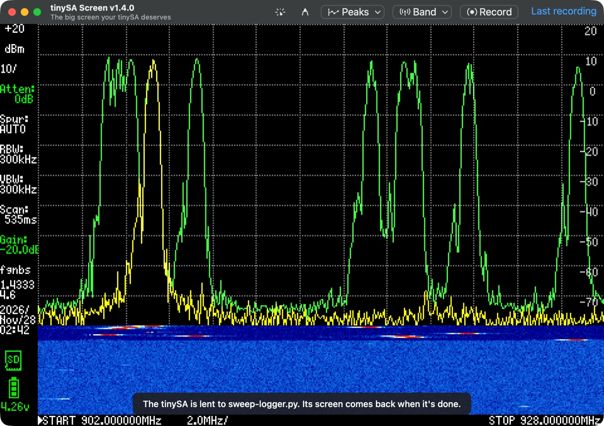

- **Feeding.** A program that keeps the analyzer all day (a monitor or a logger) can show its screen in the window
  instead: while tinySA Screen is open, the program writes the screen as a PNG, plus a few words about what it's doing,
  to a folder the app watches. tinySA Screen then shows those pictures and never touches the analyzer. Recording works
  on fed pictures too, and clicks reach the analyzer through the program when it passes them on.
- **Asking.** A program can ask the open app for a GIF, a screenshot or its status, through the
  [command line](#the-command-line) or the socket behind it.

## How it works

tinySA Screen speaks the analyzer's USB console, as a terminal would. When it connects, it turns off any live screen a
crashed viewer may have left on, asks for the firmware version and the model, captures the whole screen (`capture rle`,
the screen packed into about 30 KB), then sends `refresh on`. From then on the analyzer sends every region it draws, as
it draws it, and the app paints the regions onto its copy of the screen. Clicks go back as `touch x y` and
`release x y`. GIFs come from the app's own encoder: a frame once each sweep is drawn, in its exact colours, only the
rows that changed, compressed with GIF's LZW. [docs/HOW-IT-WORKS.md](docs/HOW-IT-WORKS.md) goes into the formats, the
peak hold and the GIFs.

## Troubleshooting

| What you see | What to do |
| --- | --- |
| "Connect a tinySA by USB and switch it on." | Check the cable (a charging-only cable doesn't carry data) and the switch on the analyzer. |
| "The tinySA is in use by another program" | Quit that program (another viewer, a terminal, NanoVNA-Saver or QtTinySA), or have it [borrow](docs/INTEGRATION.md#borrowing) the analyzer. |
| "The tinySA doesn't answer over USB." | Switch the analyzer off and on. Firmware before v1.4-223 could leave its console unable to answer after hours of use; [update it](#updating-the-firmware). |
| The analyzer's own screen froze after tinySA Screen crashed | Open tinySA Screen again (it turns the analyzer's live screen off as it connects), or switch the analyzer off and on. |
| The peaks all went at once | The hold starts over when the span changes, on Clear Peaks, or when its period changes. The app logs why: `/usr/bin/log show --predicate 'subsystem == "io.github.tolgabalci.tinysa-screen"' --last 1h` (the full path, since zsh has a `log` command of its own). |
| macOS says the app "can't be opened" | Only versions before 1.1.0, which weren't notarized: right-click › Open the first time, or System Settings › Privacy & Security › Open Anyway. |

### Updating the firmware

The tinySA's maker publishes each firmware release in the [tinySA4 download folder](https://athome.kaashoek.com/tinySA4/DFU/)
(the Ultra models) with its changelog, and explains how to install it on the [tinySA wiki](https://tinysa.org/wiki/).
From v1.4-252 on, the analyzer can also update itself from its SD card (STORAGE › MORE › UPDATE FIRMWARE).

## Contributing

Bug reports, ideas and pull requests are welcome: see [CONTRIBUTING.md](CONTRIBUTING.md). Reports about tinySA models
and firmware versions this hasn't been tried with are especially useful.

## Acknowledgments

- The [tinySA](https://tinysa.org) is designed by Erik Kaashoek. Its firmware ([on GitHub](https://github.com/erikkaashoek/tinySA))
  has the live screen and touch commands this app uses, made for the Windows app tinySA-App.
- `capture rle` sends the screen in the RLE8 format of DiSlord's NanoVNA-D firmware.

tinySA Screen is an independent project, not made or endorsed by the makers of the tinySA.

## License

[MIT](LICENSE) © 2026 Tolga Balci
